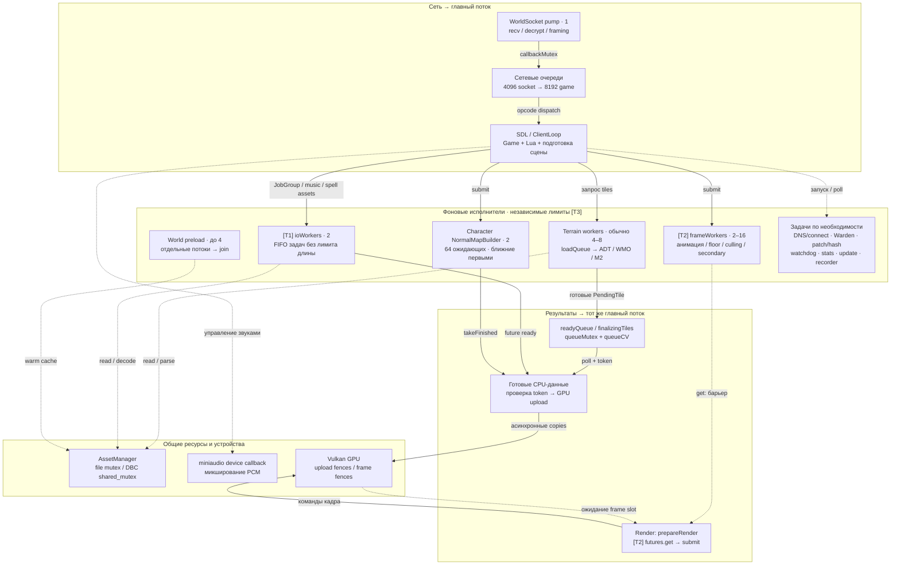
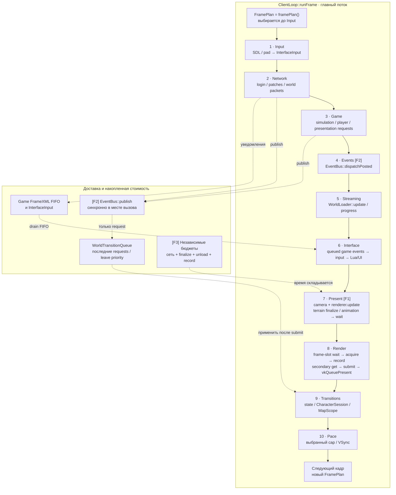
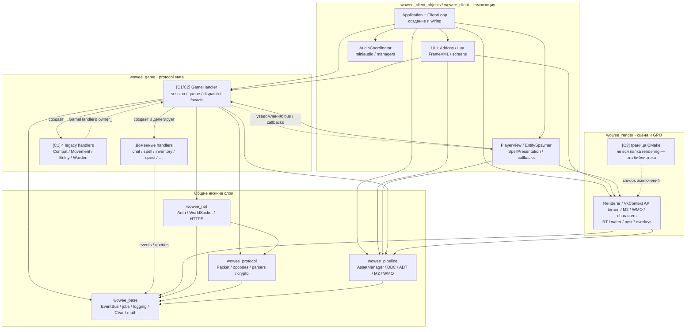
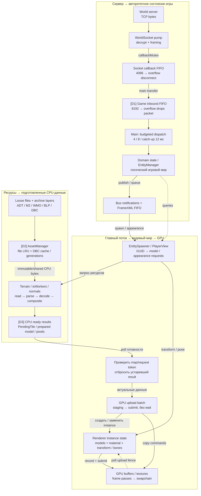
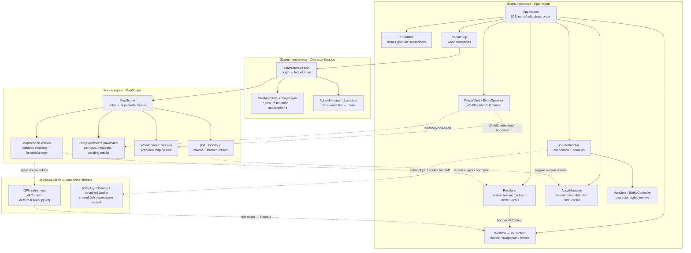

# WoWee — архитектурный атлас

Снимок: 2026-10-19, HEAD `9f10869` + рабочее дерево. Все выводы основаны на статическом чтении кода; runtime-профиль не снимался.

[Открыть общий обзор](index.html). Пять отдельных HTML-артефактов работают без сети. В каждом диаграмма находится рядом с проблемами и ссылками на код. SVG/PNG предназначены для просмотра и экспорта, Mermaid/DOT — для редактирования.

Обозначения: **Факт** — проверено в коде; **Риск** — возможное следствие, требующее воспроизведения/замера; **Долг** — текущая архитектурная связанность. Это описание реализации, не проект исправлений. Номера строк относятся к снимку; хеши исходников сохранены в `sources.json`.

Существовавшие локальные изменения server_extension и warden не изменялись. Результаты проверок относятся к прочитанному рабочему дереву. `docs/threading.md` использовался только как ориентир: его описания detached normal-map tasks и самостоятельных loading frames расходятся с текущей реализацией.

## Артефакты

- [Threading Model](01-threading-model.html) · [SVG](diagrams/01-threading-model.svg) · [PNG](diagrams/01-threading-model.png) · [Mermaid](diagrams/01-threading-model.mmd)
- [Frame Lifecycle](02-frame-lifecycle.html) · [SVG](diagrams/02-frame-lifecycle.svg) · [PNG](diagrams/02-frame-lifecycle.png) · [Mermaid](diagrams/02-frame-lifecycle.mmd)
- [Component Diagram](03-component-diagram.html) · [SVG](diagrams/03-component-diagram.svg) · [PNG](diagrams/03-component-diagram.png) · [Mermaid](diagrams/03-component-diagram.mmd)
- [Data Flow Diagram](04-data-flow.html) · [SVG](diagrams/04-data-flow.svg) · [PNG](diagrams/04-data-flow.png) · [Mermaid](diagrams/04-data-flow.mmd)
- [Ownership / Lifetime Model](05-ownership-lifetime.html) · [SVG](diagrams/05-ownership-lifetime.svg) · [PNG](diagrams/05-ownership-lifetime.png) · [Mermaid](diagrams/05-ownership-lifetime.mmd)

## Threading Model

Кто работает параллельно, через что передаёт результат и где кадр обязан ждать.

Сплошные стрелки — передача работы или данных. Пунктир — ожидание или общие ресурсы. GPU — отдельная исполнительная область, не C++-поток.

### Что подсвечивает

**T1 · Факт → риск · Все обычные I/O-задачи делят два FIFO-воркера**

JobGroup отправляет map/entity preparation в тот же ioWorkers, что чтение музыки и spell assets. Очередь ThreadPool не ограничена и не имеет приоритетов. Длинный backlog может задерживать появление близких объектов или запуск музыки.

Следующий шаг: Измерять время ожидания в очереди, её длину и тип задачи; затем вводить приоритеты и backpressure по общему контракту.

- [include/core/thread_pool.hpp:59](/mnt/d/games/WoWee/include/core/thread_pool.hpp:59)
- [include/core/thread_pool.hpp:73](/mnt/d/games/WoWee/include/core/thread_pool.hpp:73)
- [include/core/job_group.hpp:116](/mnt/d/games/WoWee/include/core/job_group.hpp:116)
- [src/audio/music_manager.cpp:136](/mnt/d/games/WoWee/src/audio/music_manager.cpp:136)

**T2 · Факт → риск · Параллельная работа остаётся на критическом пути кадра**

Главный поток ждёт M2 animation в Present и окончания secondary command buffers в Render. Это необходимые барьеры: длительность кадра зависит от самого долгого незавершённого задания, даже если остальные воркеры свободны.

Следующий шаг: Профилировать очередь отдельно от выполнения и ожидания get; сохранять барьер перед чтением изменяемых spatial/animation данных.

- [src/rendering/renderer.cpp:2394](/mnt/d/games/WoWee/src/rendering/renderer.cpp:2394)
- [src/rendering/renderer.cpp:3344](/mnt/d/games/WoWee/src/rendering/renderer.cpp:3344)

**T3 · Риск · Нет единого лимита фоновой загрузки CPU**

Frame pool, terrain pool, preload, normal maps и std::async задают параллелизм независимо. Их одновременная активность может вытеснять главный поток. Это риск oversubscription, а не доказанный замер фриза.

Следующий шаг: Снять профиль холодного входа в город: runnable threads, загрузка CPU и задержки main; учитывать все активные пулы.

- [src/rendering/terrain_manager.cpp:104](/mnt/d/games/WoWee/src/rendering/terrain_manager.cpp:104)
- [include/core/thread_pool.hpp:82](/mnt/d/games/WoWee/include/core/thread_pool.hpp:82)
- [src/core/world_loader.cpp:600](/mnt/d/games/WoWee/src/core/world_loader.cpp:600)
- [src/rendering/character_renderer.cpp:71](/mnt/d/games/WoWee/src/rendering/character_renderer.cpp:71)

### Обязанности и границы

| Область | Поведение |
|---|---|
| Главный поток | SDL, сетевой dispatch, домены игры, UI/Lua, upload/finalization и Vulkan submit/present. Отдельного постоянного render thread нет. |
| Сеть | Опциональный pump; WOWEE_NET_ASYNC_PUMP=0 переносит чтение на main. ioMutex защищает socket/cipher, callbackMutex — очередь. |
| Terrain | queueMutex + queueCV; readyQueue ограничивает старт новой подготовки при глубине ≥3, есть MemoryMonitor throttling. Уже выполняемые задачи могут добавить результаты. |
| Frame workers | 2–16 потоков, по умолчанию hardware_concurrency−1 с clamp; общий пул для анимации, коллизий, visibility и записи secondary commands. |
| I/O workers | 2 потока; JobGroup даёт token и lifetime fence, а не собственный пул. |
| Normal maps | У CharacterRenderer собственный NormalMapBuilder: 2 потока, очередь 64, приоритет расстояния, completed results → main. |
| World preload | До 4 потоков на прогрев файлов; отдельная отмена и join, не общий ioWorkers. |
| Прочие роли | DNS/connect detached с shared job; Warden/patch/hash/background decode — task-scoped; watchdog и ProcessStats — отдельные потоки; recorder и встроенный asset panel — условные. Число потоков библиотек/драйвера отдельно не инвентаризировалось. |

**Существующая защита:** Сетевой pump не меняет EntityManager. Данные карты помечаются token, нормальные фоновые consumer-пути опрашивают готовность; GPU upload и управление Vulkan остаются у main.

## Frame Lifecycle

Один неизменяемый FramePlan на кадр и десять фаз в фактическом порядке.

Сплошная цепочка — порядок вызовов. Пунктир — отложенная доставка или влияние на последующую фазу. Present здесь означает подготовку сцены; показ swapchain происходит внутри Render.

### Что подсвечивает

**F1 · Факт · Streaming не содержит всей работы стриминга**

Фаза Streaming опрашивает WorldLoader и loading scene, но terrain.update → processReadyTiles выполняется в Renderer::update, вызванном из Present. Название фазы не отражает всю её стоимость; смотреть только метрику Streaming недостаточно.

Следующий шаг: При анализе фризов раскрывать Present на terrain finalization, unload, animation и wait; не переносить вызовы без проверки зависимостей.

- [src/core/application.cpp:4071](/mnt/d/games/WoWee/src/core/application.cpp:4071)
- [src/core/application.cpp:4093](/mnt/d/games/WoWee/src/core/application.cpp:4093)
- [src/rendering/renderer.cpp:2277](/mnt/d/games/WoWee/src/rendering/renderer.cpp:2277)
- [src/rendering/terrain_manager.cpp:231](/mnt/d/games/WoWee/src/rendering/terrain_manager.cpp:231)

**F2 · Факт → риск · Events — не единственное место выполнения подписчиков**

publish вызывает подписчиков сразу, например из Network или Game. Только post ждёт Events. FrameXML идёт отдельной FIFO в Interface; его обработчик может видеть более новое состояние игры, чем в момент публикации.

Следующий шаг: Указывать канал и фазу у нового события; синхронные подписчики переходов должны только записывать запрос. Стоимость publish относится к фазе отправителя.

- [include/core/event_bus.hpp:85](/mnt/d/games/WoWee/include/core/event_bus.hpp:85)
- [include/core/event_bus.hpp:100](/mnt/d/games/WoWee/include/core/event_bus.hpp:100)
- [src/core/client_loop.cpp:341](/mnt/d/games/WoWee/src/core/client_loop.cpp:341)
- [docs/principles/client-frame-phases.md:34](/mnt/d/games/WoWee/docs/principles/client-frame-phases.md:34)

**F3 · Факт → риск · Локальные бюджеты не дают общего потолка кадра**

Сеть по умолчанию получает 4 мс в мире, 8 мс при входе и 12 мс при catch-up. Terrain finalize получает 2/8/16 мс, unload — ещё 8/16 мс. Это независимые лимиты; проверка между операциями не прерывает один долгий шаг. Это настройки времени, не измеренная длительность кадра.

Следующий шаг: Сопоставлять суммарные CPU-фазы с целевым временем кадра и отдельно отмечать overruns одной операции и ожидания GPU.

- [src/game/game_handler_packets.cpp:87](/mnt/d/games/WoWee/src/game/game_handler_packets.cpp:87)
- [src/game/game_handler_packets.cpp:101](/mnt/d/games/WoWee/src/game/game_handler_packets.cpp:101)
- [src/rendering/terrain_manager.cpp:1529](/mnt/d/games/WoWee/src/rendering/terrain_manager.cpp:1529)
- [src/rendering/terrain_manager.cpp:1591](/mnt/d/games/WoWee/src/rendering/terrain_manager.cpp:1591)

### Обязанности и границы

| Область | Поведение |
|---|---|
| Input | beginFrame вычисляет dt; FramePlan уже выбран. SDL/pad читаются, Lua-backed input копится для Interface. |
| Network | Auth/patch update, world socket transfer и ограниченный по времени opcode dispatch. Часть синхронных уведомлений возникает уже здесь. |
| Game | Симуляция, reconnect, logout timeout, player/world client logic; подготовка запросов отображения. |
| Events | Снимок posted queue → подписчики. Новые post из обработчика остаются до следующего dispatch. |
| Streaming | WorldLoader polling и прогресс, загрузочная сцена. Нет вложенного SDL/game/render цикла. |
| Interface | Вход интерфейса в мир, bindings, queued FrameXML, input, screens, ReloadUI, addon update, draw lists. При уходе — PLAYER_LEAVING_WORLD. |
| Present | PlayerView и передача мира, Renderer::update, terrain finalization/unload, animation + get, наблюдение readiness загрузки. |
| Render | Renderer beginFrame → frame-slot fence/timeline wait + acquire → запись проходов → secondary barriers → endFrame submit/present. |
| Transitions | Запросы world entry, transfer, logout, reconnect, state. Только здесь создают/заканчивают мировые lifetimes. |
| Pace | Единственное pacing место. Выбранный cap, VSync через presentation; затем Idle и отчёт frameFinished. |

**Существующая защита:** LOADING_WORLD проходит тот же цикл: сеть и simulation продолжаются, интерфейс показывает прогресс, готовность проверяется после Present. Мутации lifetime применяются после submit; Lua entry защищён фазой Interface. Закрытие окна может прервать кадр после Input или Interface.

## Component Diagram

Направления зависимостей библиотек и связи между подсистемами клиента.

Сплошная стрелка A → B означает «A зависит от B». Пунктир внутри клиента — runtime-взаимодействие. Транзитивные и внешние библиотечные зависимости частично опущены.

### Что подсвечивает

**C1 · Подтверждённый долг · Четыре домена всё ещё зависят от всего GameHandler**

Статическая проверка: 4 handlers с GameHandler&, 1206 обращений через owner_, 110 xxxRef-accessors. Имена доменов уже выделены, но часть их зависимостей и владения состоянием остаётся неявной.

Следующий шаг: Переносить state к владельцу и передавать узкие PacketSender / FrameXmlEvents / Query interfaces; не добавлять новые owner_. и Ref-пути.

- [tools/domain_shape_check.py:54](/mnt/d/games/WoWee/tools/domain_shape_check.py:54)
- [src/game/game_handler.cpp:116](/mnt/d/games/WoWee/src/game/game_handler.cpp:116)
- [include/game/game_handler.hpp:143](/mnt/d/games/WoWee/include/game/game_handler.hpp:143)

**C2 · Долг → риск · Сохраняются каналы уведомления с одним слушателем**

В GameHandler осталось 50 set*Callback setters. Они требуют ручного wiring и допускают замену предыдущего слушателя. Само число не доказывает потерю события сейчас, но показывает объём неявного контракта.

Следующий шаг: При изменении существующего уведомления переходить на типизированное событие и RAII Subscription; FrameXML оставить отдельным контрактом Lua.

- [tools/domain_shape_check.py:47](/mnt/d/games/WoWee/tools/domain_shape_check.py:47)
- [src/core/client_loop.cpp:38](/mnt/d/games/WoWee/src/core/client_loop.cpp:38)
- [include/core/event_bus.hpp:38](/mnt/d/games/WoWee/include/core/event_bus.hpp:38)

**C3 · Подтверждённый долг · Граница подсистемы не совпадает с путём файла**

CMake исключает camera_controller, animation_controller, spell visuals и другие presentation-файлы из wowee_render. В game также остаётся 6 includes общих animation/movement constants из rendering/. Это усложняет определение владельца по каталогу.

Следующий шаг: Ориентироваться на CMake targets и guard checks; общие protocol/animation IDs постепенно переносить в нейтральные headers.

- [CMakeLists.txt:1249](/mnt/d/games/WoWee/CMakeLists.txt:1249)
- [tools/render_dependency_check.py:58](/mnt/d/games/WoWee/tools/render_dependency_check.py:58)
- [tools/game_dependency_check.py:46](/mnt/d/games/WoWee/tools/game_dependency_check.py:46)

### Обязанности и границы

| Область | Поведение |
|---|---|
| Client | Application владеет и связывает game, render, assets, UI и audio; ClientLoop управляет кадром и transitions. UI, addons, audio показаны как подсистемы, а не отдельные wowee_* targets. |
| Game | Domain handlers владеют своими opcode/state; GameHandler сохраняет session/dispatch и legacy facade. Команды идут владельцу, queries — через interfaces, notifications — в bus. |
| Renderer | Получает scene/presentation state, не включает game/ui/audio/network client modules. 83 source-файла в текущей проверке; compile-time границы зависят от CMake. |
| Pipeline | Загрузка файлов, архивные слои, кеши и парсеры. Зависит от base, не от game/render клиента. |
| Network / protocol | Сеть использует protocol; game использует net и protocol. Сетевые transport-данные не вызывают GPU напрямую. |
| Headless validation | GameHarness ведёт real GameHandler без client; scene_render связывает wowee_render без game. ClientHarness ведёт тот же ClientLoop с front-end stand-ins. |

**Существующая защита:** Проверки дали 0 includes presentation из game и 0 includes клиента из wowee_render. Общие константы из rendering учитываются отдельно. Это успешная статическая проверка includes, не доказательство отсутствия всех runtime-зависимостей.

## Data Flow Diagram

Два входа — сервер и ресурсы — сходятся в presentation scene перед GPU.

Сплошные стрелки показывают движение данных. Пунктир — уведомления, повторные запросы или подтверждение готовности. Логическая Entity и GPU instance имеют разных владельцев.

### Что подсвечивает

**D1 · Подтверждённая проблема при переполнении · Игровая очередь теряет пакеты и продолжает сессию**

При заполнении 8192 slots enqueueIncomingPacket удаляет самый старый пакет; enqueueIncomingPacketFront удаляет самый новый. Это общий протокольный поток, поэтому может пропасть не только промежуточное движение, но и изменение состояния. Socket queue при собственном overflow, напротив, закрывает соединение.

Следующий шаг: Нужна явная recovery/resync политика. До доказанной безопасной coalescing-семантики нельзя произвольно отбрасывать пакеты состояния. Сценарий overflow требует отдельного поведенческого теста.

- [src/game/game_handler_packets.cpp:3054](/mnt/d/games/WoWee/src/game/game_handler_packets.cpp:3054)
- [src/game/game_handler_packets.cpp:3065](/mnt/d/games/WoWee/src/game/game_handler_packets.cpp:3065)
- [src/network/world_socket.cpp:791](/mnt/d/games/WoWee/src/network/world_socket.cpp:791)

**D2 · Факт → риск · Параллельные cache miss одного файла могут дублировать I/O**

readFileShared сначала проверяет cache, затем читает источник вне lock, затем вставляет результат. In-flight request table в этом пути нет: несколько воркеров на холодном файле могут одновременно прочитать его. Generation защищает актуальность cache, но не объединяет запросы.

Следующий шаг: Сначала измерить дубликаты cold reads и peak decoded bytes; если существенно — объединять одновременные запросы по нормализованному ключу и generation.

- [src/pipeline/asset_manager.cpp:804](/mnt/d/games/WoWee/src/pipeline/asset_manager.cpp:804)
- [src/pipeline/asset_manager.cpp:813](/mnt/d/games/WoWee/src/pipeline/asset_manager.cpp:813)

**D3 · Риск · Порог readyQueue измеряет tiles, а не память всех результатов**

Порог 3 проверяется перед началом terrain preparation; уже работающие workers могут положить дополнительные tiles. Разные tiles содержат разное количество decoded pixels и моделей. MemoryMonitor уже замедляет загрузку, но этот порог не является жёстким byte cap всего pipeline.

Следующий шаг: Наблюдать queued + preparing + ready + finalizing CPU bytes и staging bytes; оценивать backpressure по общему объёму, сохраняя прогресс хотя бы одного tile.

- [include/rendering/terrain_manager.hpp:522](/mnt/d/games/WoWee/include/rendering/terrain_manager.hpp:522)
- [src/rendering/terrain_manager.cpp:1439](/mnt/d/games/WoWee/src/rendering/terrain_manager.cpp:1439)
- [src/rendering/terrain_manager.cpp:1462](/mnt/d/games/WoWee/src/rendering/terrain_manager.cpp:1462)

### Обязанности и границы

| Область | Поведение |
|---|---|
| Сетевой handoff | Фоновая очередь socket → main → очередь game. Первая защищена mutex; вторая — main-thread-only и бюджетирована по времени. |
| Домены | Packet parser + opcode handler изменяют state. EntityController владеет entities; отображение получает события и запрашивает state. |
| Ресурсный handoff | Workers готовят CPU-результаты. Main опрашивает future/ready queue и проверяет token карты и запроса перед использованием. |
| Актуальность | JobGroup::replace(channel, GUID) отменяет предыдущий запрос; map cancellation отсекает результаты старой карты, даже если GUID переиспользован. |
| GPU handoff | Upload batch записывает copies и submit с fence. Fence опрашивается в последующих кадрах. Наличие готовых CPU bytes не равнозначно завершённому upload. |
| UI / audio branches | FrameXML FIFO читается в Interface; audio callbacks и presentation-подписчики выбирают звуки на основании игровых событий. Эти ветви не превращают game в renderer. |

**Существующая защита:** Есть parse/read limits, bounded packet queues, packet-lag catch-up, terrain memory throttling, request tokens и асинхронные upload batches. Выявленные проблемы относятся к overflow policy и сквозному учёту нагрузки, а не к отсутствию этих механизмов.

## Ownership / Lifetime Model

Владение, заимствованные ссылки и границы освобождения CPU/GPU объектов.

Сплошная стрелка owner → child — владение (unique_ptr или value). Пунктир — заимствованная ссылка. Пунктир с подписью retire — отложенное освобождение GPU, не владение.

### Что подсвечивает

**O1 · Факт → риск · Отмена задач не делает teardown мгновенным**

MapScope отменяет jobs, уничтожает load session, останавливает terrain и вызывает wait. JobGroup учитывает lease ещё до постановки в общую I/O FIFO. Поэтому отменённая, но ещё не запущенная задача может ждать предыдущие чужие задачи; уже идущий read/parse не прерывается токеном.

Следующий шаг: Измерять Transitions и возраст отменённых jobs; при требовании ограниченной задержки нужен scheduler с удалением queued cancelled work или эквивалентный контракт fence.

- [src/core/map_scope.cpp:37](/mnt/d/games/WoWee/src/core/map_scope.cpp:37)
- [include/core/job_group.hpp:115](/mnt/d/games/WoWee/include/core/job_group.hpp:115)
- [src/core/world_loader.cpp:93](/mnt/d/games/WoWee/src/core/world_loader.cpp:93)
- [include/core/thread_pool.hpp:73](/mnt/d/games/WoWee/include/core/thread_pool.hpp:73)

**O2 · Долг → риск · Безопасность borrowed ссылок зависит от ручного teardown order**

Renderer заимствует VkContext у Window; spawner — SpawnState карты, WorldLoader — Session load. Application::shutdown явно уничтожает клиентские lifetime до assets/device/window. CharacterSession также вручную сбрасывает состояние process-wide presenters. Эти связи не выражены одним owner tree.

Следующий шаг: Новые подписки хранить RAII-членами; для каждого нового borrowed указателя указать lifetime. Проверять logout, same-map reconnect, superseded load и exit, сохраняя порядок stop/join → release.

- [include/core/window.hpp:85](/mnt/d/games/WoWee/include/core/window.hpp:85)
- [include/rendering/renderer.hpp:620](/mnt/d/games/WoWee/include/rendering/renderer.hpp:620)
- [src/core/application.cpp:2104](/mnt/d/games/WoWee/src/core/application.cpp:2104)
- [src/core/character_session.cpp:67](/mnt/d/games/WoWee/src/core/character_session.cpp:67)

**O3 · Факт → риск · AsyncConnect.cancel оставляет DNS/connect работать до возврата**

Detached worker удерживает shared Job, а cancel ставит abandoned. Это сохраняет память и закрывает поздний socket, но не прерывает connectBlocking / DNS. Повторные попытки могут временно перекрываться по потокам; реальная задержка здесь не измерялась.

Следующий шаг: Если нужна строгая отмена и ограничение повторов — ограничивать число connect jobs и использовать отменяемый transport/resolver. Не заменять shared Job захватом сырого owner.

- [include/network/async_connect.hpp:41](/mnt/d/games/WoWee/include/network/async_connect.hpp:41)
- [include/network/async_connect.hpp:84](/mnt/d/games/WoWee/include/network/async_connect.hpp:84)

### Обязанности и границы

| Область | Поведение |
|---|---|
| Создание | Application строит долгоживущие сервисы. ClientLoop в Transitions создаёт CharacterSession; CharacterSession::enterMap заменяет только MapScope. |
| Смена карты | Сначала уничтожается прежний MapScope, даже при повторном входе в тот же map ID. InterfaceState, Lua и остальная сессия персонажа сохраняются. |
| Reconnect | Сцена может стоять во время восстановления соединения. При успешном same-map reconnect MapScope передаётся releaseMap/adoptMap новой CharacterSession; новый Lua interface слышит login заново. |
| Деструктор карты | cancel tokens → unbind spawner → load.reset / terrain.stopWorkers → jobs.wait → detach player/transport references → render session release. Process-wide model/texture caches сохраняются. |
| Деструктор персонажа | MapScope уходит первым; затем AddonManager сохраняет переменные и закрывает Lua внутри Interface scope; затем остальное per-character state и subscriptions. |
| GPU lifetime | MapRenderSession освобождает logical instance contents; Vulkan destruction откладывается за slot fences. В обычном map teardown нет vkDeviceWaitIdle; shutdown приложения использует device idle перед освобождением device resources. |
| Типы владения | unique_ptr/value: единственный владелец. shared_ptr<const bytes/table>: разделяемые CPU-данные. Raw pointers/references: borrow и обязательный порядок уничтожения. Token: актуальность/отмена, не владение Renderer или AssetManager. |

**Существующая защита:** MapScope и CharacterSession уже объединяют основные lifetime. JobGroup fence удерживает CPU-задачи до их завершения, RAII Subscription отключает слушателя, deferred GPU cleanup защищает ещё используемые ресурсы. Кеш между картами сам по себе не является утечкой.

## Проверки и воспроизведение

`checks.txt` содержит вывод `domain_shape_check.py`, `game_dependency_check.py`, `render_dependency_check.py`. Они проверяют связанность/includes, а не поведение рендера или сети. Клиент не собирался и не перезапускался: изменения только документальные.

Генерация: `python3 docs/architecture-atlas/generate.py` (Python 3 + Graphviz `dot`). Генератор пишет только в эту папку; TMP/TEMP/TMPDIR дочерних процессов направлены в `build-dev/tmp` на D:. PNG и SVG строятся из DOT; Mermaid передаёт тот же набор узлов и связей, его layout может отличаться.

HTML не использует CDN, шрифты из сети или внешние скрипты. SVG/PNG содержат саму схему; пояснения рядом и ссылки доступны в HTML и Markdown. Для печати всего обзора можно использовать печать HTML в PDF.
