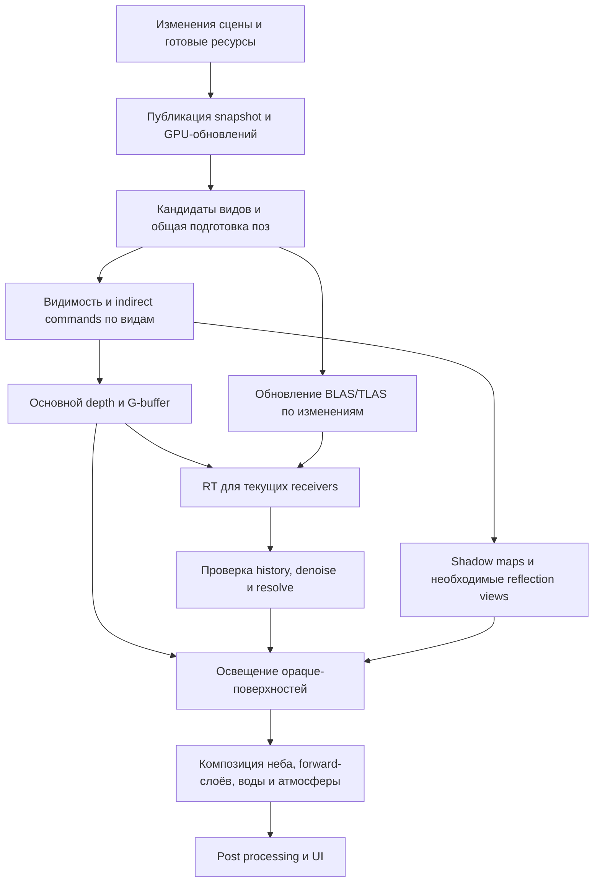

# Требования к новому rendering pipeline WoWee

Дата: 2026-10-22. Статус: требования для реализации и проверки; ускорение новой архитектуры ещё не измерено.

## 1. Цель и основание

Повысить FPS и сократить CPU/GPU-затраты и временную память без удаления эффектов, объектов или качества материалов. Устранить повторную подготовку одних данных для разных проходов и зависимость освещения текущих поверхностей от наличия этих поверхностей в экранном RT-буфере прошлого кадра.

Сейчас opaque shading предшествует RT, поскольку RT использует оставленный геометрией depth. Материалы читают предыдущий результат через reprojection и расширяющийся поиск подходящей поверхности. В изолированном WMO Даларана отключение только RT lookup уменьшило WMO GPU mean с 7.62 до 2.57 мс; удаление широких recovery-колец — до 4.28 мс. Эти режимы меняют изображение и не являются исправлением или целевой производительностью нового pipeline. Подробности и ограничения: [исследование WMO](../tasks/performance/dalaran-wmo-gpu-investigation.md).

Базовое проектное решение: **постоянная GPU-сцена, компактный G-buffer для подходящих opaque/alpha-cutout материалов, RT по текущей видимой поверхности и отдельный forward-путь для материалов с порядком смешивания**. Visibility buffer можно исследовать позднее как замену G-buffer при доказанном выигрыше с тем же поведением.

В документе «обязательно» означает критерий приёмки. Оптимизации, помеченные как условные, вводятся после измерения и не должны блокировать корректную первую реализацию.

## 2. Границы работы

В область реализации входят terrain, WMO, M2, персонажи и их attachments, shadow passes, RT, отражения, прозрачность, вода, связанная композиция тумана и управление ресурсами кадра.

Сохраняются форматы ассетов, игровая модель, существующие режимы качества и визуальные правила. Переписывание игры на ECS или тотальную событийную модель не требуется. События и команды передают изменения в presentation/rendering; движение камеры, анимация, время и погода продолжают обновляться по кадрам.

Не входят автоматически: переход к другой модели материалов/PBR, новое качество RT, добавление персонажей в RT-casters и изменение правил streaming. Сейчас персонажи получают RT-освещение, но отбрасывают тени через shadow map; это поведение сохраняется, пока расширение RT-casters не спроектировано отдельно.

## 3. Что означает «без двойных обходов»

Обязательно:

- Статические данные resident-сцены не пересобираются и не копируются целиком каждый кадр.
- Изменения instance/material/geometry публикуются один раз; несколько изменений одного поля до публикации объединяются в итоговое состояние. Удаление и повторное создание различаются поколением ID.
- Общие данные экземпляра, необходимые нескольким проходам, подготавливаются один раз для соответствующей версии состояния. Проходы используют handles/диапазоны, а не повторно извлекают объект из игровой сцены.
- Поза анимации рассчитывается один раз на instance и simulation time и используется камерой, тенями, отражениями и RT, когда он поддерживает этот объект.
- CPU-затраты подготовки в установившейся сцене зависят от изменений, активных анимаций и кандидатов пространственных запросов. Количество проходов не должно умножать полный обход всех resident instances.

Допустимы отдельные spatial queries, фильтрация компактных списков кандидатов и GPU-проходы для разных видов. Главная камера, отражённая камера, shadow cascades и RT-region имеют разные области интереса. Нельзя выбрасывать offscreen caster только потому, что он не виден главной камере.

Один geometry pass означает один основной проход подходящей opaque/alpha-cutout геометрии камеры, создающий depth и G-buffer. Это не обещание единственного draw каждой модели за весь кадр: тени, отражения, прозрачные слои и RT acceleration structures остаются отдельной работой. Повторный depth prepass вводится только при измеренном выигрыше и корректном alpha-test.

## 4. Владение состоянием и контракт данных

| Данные | Владелец и срок жизни | Правило обновления |
|---|---|---|
| Mesh, submesh, индексы, исходные вершины, описание материала | Реестр ресурсов renderer; совместное использование экземплярами | Загрузка/замена/выгрузка, не копирование на каждый draw |
| Instance: transform, bounds, material bindings, render flags | Постоянная render scene со стабильным ID и поколением | Команды изменений и версии отдельных категорий |
| Поза, attachments, деформированные bounds | Подсистема анимации/presentation с публикацией renderer | Только при изменении; общая версия для всех потребителей кадра |
| GPU mesh/material/instance tables | Renderer, управляемое отражение опубликованной CPU-сцены | Dirty ranges; определённый момент видимости обновлений GPU |
| Видимость и draw/dispatch lists | Snapshot конкретного вида/кадра | Spatial query и cull; ссылки на закреплённые версии ресурсов |
| BLAS/TLAS и RT-membership | RT scene, использующая те же ID и версии | Изменения геометрии, transform и состава региона |
| Предыдущие transform/pose и lighting history | Renderer, история реально отрисованных кадров | Обновление по успешной публикации/выполнению, явная инвалидизация |

Требования к реализации:

1. У каждого состояния один авторитетный владелец. CPU/GPU-представления разрешены, но правила синхронизации и версии явные. Не создавать независимые копии мира для raster и RT.
2. Сохранить фазы `ClientLoop`: подготовка и публикация до Render, переходы мира в Transitions. Обработчик игрового события не уничтожает сцену, которую ещё использует кадр.
3. `record*` читает неизменяемый snapshot и закреплённые ресурсы; не читает живую `scene_`. Постоянные GPU-таблицы версионируются, буферизуются либо обновляются с зависимостями, исключающими перезапись данных незавершённого кадра.
4. Освобождение handles, descriptors, buffer ranges и AS происходит после последнего CPU-reader и GPU-use. Fence retirement не заменяет синхронизацию CPU-контейнеров.
5. Пропуск кадра, смена карты, despawn и переиспользование ID не теряют изменения и не применяют старый worker-result к новому объекту. Очередь изменений имеет определённое подтверждение потребления.
6. `wowee_render` сохраняет независимость от game/UI/audio/network; `scene_render` использует тот же production pipeline.

### 4.1. Совместимость с отдельным render thread и frames in flight

Существующая схема сохраняется: producer в Present резервирует `FrameWorker::Permit`, публикует `shared_ptr<const FrameInputs>` с `FrameScene`; один recording owner выполняет `beginFrame/renderWorld/endFrame`. `FrameWorker` ограничивает число зарезервированных/незавершённых CPU-заданий двумя, а Vulkan отдельно поддерживает два frames in flight. Это разные ограничения и разные моменты завершения.

Обязательный контракт:

1. Различать `worldEpoch`, sequence опубликованной сцены, номер GPU submission и переиспользуемый frame slot. Slot не является идентификатором истории, а sequence сцены не доказывает завершение GPU. Повторная запись snapshot не применяет его delta дважды.
2. Producer может готовить N+1, пока render thread записывает N, а GPU исполняет более раннюю submission. Ни один участник не изменяет опубликованную версию другого. Данные pose/camera/material/RT внутри одной записи принадлежат согласованному snapshot.
3. G-buffer, RT intermediates, writable instance/pose ranges, indirect commands и descriptors защищены до окончания всех GPU-читателей. Для параллельно используемых версий нужны отдельные ranges/images/sets либо явная GPU-зависимость перед повторным использованием. Неизменяемые meshes/textures общие; дублировать весь мир на каждый slot не требуется.
4. При GPU-таблицах на каждый slot обновление доводит выбранную таблицу от её собственной последней версии до версии snapshot. Нельзя загрузить только delta последнего producer-кадра: slot мог пропустить несколько изменений. Journal/dirty tracking сохраняет необходимые данные до потребления всеми нужными версиями.
5. Существующие `SnapshotLease` и `RetireQueue` сохраняют защиту как ещё не записанных CPU-snapshots, так и GPU submissions. Возврат `Permit` означает завершение CPU-задания, не разрешение перезаписывать GPU-ресурсы. Любые дополнительные compute/transfer queues включаются в учёт последнего использования.
6. «RT текущего кадра» означает цепочку `G-buffer N → RT N → lighting N` на GPU. Она не требует возвращать результат RT на CPU или останавливать producer. Barriers/semaphores обеспечивают зависимости; новые `deviceWaitIdle` или CPU fence waits между этими проходами недопустимы. Существующее ожидание свободного frame slot остаётся отдельным backpressure.
7. Temporal history ссылается на предыдущий валидный render result и соответствующие transform/pose/camera, а не просто на другую половину double buffer или предыдущий simulation tick. GPU может читать history после зависимости от её записи без CPU-ожидания; resize/cancel/skipped submission не продвигают историю к несуществующему результату.
8. Threaded и inline режимы имеют одинаковые ownership/sequence semantics. Тесты с задержанным consumer/GPU, несколькими изменениями между использованиями slot и unload при незавершённых кадрах подтверждают отсутствие гонок, потерянных updates и преждевременного освобождения. Производительность проверяется с включённым render thread, как в целевом режиме клиента.

## 5. Зависимости кадра

Это граф зависимостей, а не требование сериализовать независимую работу. Render graph должен описывать реальные чтения/записи, layout transitions и синхронизацию graphics/compute/AS-build. Async compute включается только при выигрыше общего времени кадра.

Reflection view имеет собственную камеру, clipping и политику освещения. Если отражению нужен тот же deferred/RT-путь, он является отдельным видом со своими ресурсами и зависимостями. Нельзя образовывать рекурсивную зависимость отражения от самого себя или читать RT главной камеры как будто это тот же receiver.

### 5.1. Основной geometry pass

- G-buffer содержит достаточные данные для существующих материалов: depth, geometric normal, shading normal либо способ её восстановления, параметры/ID материала и lighting flags, motion vectors. Точный packing выбирается до реализации storage и фиксируется с оценкой памяти.
- Geometric normal для проверки совместимости RT/history отделена от normal-map/POM shading normal. Границы стен и тонкие поверхности не смешивают освещение.
- Alpha-test, UV animation, POM, wind, skinning и distance fade согласованы между цветом, depth и зависимыми проходами. Принудительный early depth с записью отброшенных alpha-фрагментов недопустим.
- Motion vectors учитывают предыдущую реальную деформацию и transform, а также camera jitter. Для объекта без валидной истории задаётся invalid history, а не случайное нулевое движение.
- Система координат и точность согласованы между raster, RT, bounds и reprojection, включая большие мировые координаты.
- MSAA и края alpha-cutout имеют явное правило покрытия и resolve. Нельзя молча снизить существующий MSAA до одного sample.

### 5.2. RT, history и resolve

- RT получает receivers из текущего depth/G-buffer. При отключённой history или на первом кадре освещение должно быть корректным в пределах выбранного режима качества, хотя шум может быть выше.
- History уменьшает шум и стоимость оценки освещения; она не является единственным источником данных о вновь открытой поверхности.
- Half-resolution RT сохраняет идентичность выбранного receiver. Resolve использует depth, geometric normal и validity; не переносит освещение через силуэты, тонкую геометрию или независимые слои.
- Если текущая поверхность не представлена подходящим sample, алгоритм должен обнаружить это и получить корректную текущую оценку — например, через компактный список дополнительных rays. Политика бюджета и качества должна быть явной и наблюдаемой; широкий поиск по устаревшему экранному буферу не является способом закрывать такие пропуски.
- Denoise/resolve выполняется централизованно для каждого вида. Материалы получают готовое освещение с ограниченной стоимостью чтения; в WMO/M2/terrain fragment shaders нет адаптивных recovery-колец по старому кадру.
- History проверяется при движении, изменении освещения/материала/геометрии и сбрасывается там, где потеряла валидность. Camera cut, teleport, resize, смена карты, режима RT или разрешения не оставляют старые тени и GI.
- Статический BLAS переиспользуется. Transform экземпляра обновляет соответствующие instance/TLAS-данные; деформируемый BLAS обновляется только для поддерживаемых RT-casters с изменившейся геометрией.
- RT-region поддерживает пространственный состав и dirty updates; сдвиг камеры не вызывает безусловную пересборку всей resident-сцены. Полнота caster set проверяется отдельно от camera visibility.

### 5.3. Forward-слои и совместимость материалов

До переноса материала составляется таблица его blend/depth/cull/sort/lighting поведения. Opaque и alpha-cutout допускаются в deferred-путь только когда это сохраняет порядок и результат композиции.

Обязательно сохранить:

- WMO portal visibility, interior/exterior lighting, vertex colours/MOCV, emissive/unlit/night flags, alpha thresholds, односторонность и `F_UNCULLED`;
- M2 blend modes, priority planes, UV animation, texture combiners, environment mapping, material animation, attachments, ribbons и particles;
- terrain layers, LOD/seams, normal mapping, POM, distance bands;
- действующие правила локальных источников, character shadow maps, воды, отражений, погоды, освещения по времени суток и atmosphere/fog.

Особенно проверить WMO batches: [спецификация оригинального клиента](wow-client-render-spec.md) описывает порядок MOBA и запись depth смешиваемыми материалами. Нельзя автоматически считать всякий blended batch обычной прозрачностью без depth write или свободно пересортировать opaque вокруг него. Для несовместимых с обычным G-buffer случаев нужен явный production-путь с сохранением семантики.

Transparent receiver не получает RT непрозрачной поверхности позади него. Для прозрачности и воды документируется собственное текущее освещение: поддерживаемые screen-space данные, shadow maps, rays или другой выбранный метод с проверкой receiver. История допустима только с валидной привязкой к этому слою.

Композиция сохраняет порядок объектов по обе стороны воды, подводный режим и material blending. Fog применяется к нужному отрезку луча и слою один раз; перенос в общий post-pass не должен повторно затуманивать уже обработанные прозрачные объекты.

## 6. Culling, submission и анимация

1. WMO groups отсекаются по корректным world bounds, portal, distance и frustum данного вида. Bounds повёрнутого объекта строятся консервативно. Reflection использует отражённую камеру и корректный winding.
2. Terrain и M2 используют пространственные структуры и переиспользуемые candidate buffers. Нельзя собирать весь мир повторно для тени, RT и основного draw.
3. GPU culling формирует compact visible lists и indirect commands без синхронного readback на CPU. При использовании temporal occlusion newly visible объекты не исчезают из-за устаревшего occluder/depth.
4. Draw grouping уменьшает binds и submissions по совместимым pipeline/material состояниям. Он сохраняет порядок, существенный для blending/depth, и не требует объединять все форматы моделей в один формат ассета.
5. Capability matrix явно описывает необходимые Vulkan features. Multi-draw, descriptor indexing и другие расширения включаются после проверки поддержки; переносимый путь использует ту же сцену и порядок данных. Ограничения режима видимы пользователю и логируются один раз.
6. Bone palettes загружаются по изменениям; одинаковая поза не копируется отдельно для каждого прохода. View-dependent billboards и другие деформации выделяются явно, чтобы общий cache не подменял данные одного вида данными другого.
7. Compute skinning с переиспользованием результатов условен: измеряются стоимость dispatch, запись/чтение vertex cache, память и выигрыш на нескольких потребителях. Модели с одним потребителем не обязаны проходить дополнительный cache pass.
8. Animation relevance учитывает объединение нужд camera/shadow/reflection/RT и обязательных attachments/effects. Первичный cull до вычисления позы использует консервативные animated bounds.

## 7. Память, streaming и ошибки

- До выбора G-buffer formats составить бюджет: bytes/pixel × resolution × samples × frames in flight, history/RT images, instance/material tables, pose/skin cache, AS, staging и peak при resize. Transient aliasing разрешён только при непересекающихся сроках жизни.
- Отдельно учитывать CPU RAM и GPU memory; VRAM не является измерением общей памяти процесса. Данные выделяются из переиспользуемых буферов; нет обязательных heap allocations на каждый объект/проход установившегося кадра.
- Resident memory, очереди загрузки и временные caches ограничены явными бюджетами. После unload/смены карты и завершения GPU-use память возвращается; длительный маршрут не вызывает неограниченный рост.
- File I/O, parsing, texture decode и CPU compositing выполняются workers. Render thread принимает готовые данные и отправляет uploads без ожидания worker или синхронного чтения. Дозирование синхронной загрузки по кадрам не считается асинхронностью.
- Состояния Pending/Ready/Failed различаются. Ошибка содержит ID/path, причину и видимое последствие, логируется warning/error один раз; не повторяется бесконечно каждый кадр.
- Переполнение command/worklist buffer не теряет объекты молча. Поведение роста/повторной обработки/ограничения должно быть определено и проверено, без случайной порчи соседних ресурсов.

## 8. Проверка корректности

Тесты проходят через публичные API, сцены и production renderer. Для исправлений существующих дефектов регрессионный тест сначала должен воспроизвести ошибку. Dependency/snapshot guards остаются обязательными.

| Сценарий | Проверяемое поведение |
|---|---|
| Даларан: фиксированный ракурс и записанное движение камеры | Сохранение объектов/материалов, устойчивое текущее RT, отсутствие recovery-артефактов |
| Резкий поворот, camera cut, выход из-за стены, первый кадр без history | Новые surfaces получают своё освещение, нет старых теней и ярких полос |
| Тонкая геометрия, alpha-cutout, границы разных normals, POM | Правильные coverage/depth и отсутствие утечки RT через край |
| Движущийся персонаж, mount/attachment, wind, animated material | Совпадение позы в зависимых проходах, корректное движение/history |
| Offscreen caster, повёрнутый WMO, portal interior/exterior | Тени и RT не исчезают из-за camera cull; геометрия не отсечена ошибочно |
| Mirrored reflection, вода с объектами над/под ней, underwater | Правильные видимость, winding, порядок и fog |
| WMO blended batches, M2 multiplicative/additive материалы | Сохранение depth, authored order и blend-семантики |
| RT off/on, quality/MSAA/resolution changes, resize | Валидные ресурсы/история; сохранение выбранных режимов |
| Streaming, despawn/respawn с ID reuse, пропуск кадров, смена карты | Нет потерянных изменений, stale results, гонок и use-after-free |
| Длительное движение и повторные загрузки | Ограниченные queues/caches и освобождение памяти после retirement |

Для изображений сохраняются настройки, scene/assets и эталоны. При изменённом алгоритме изображения не обязаны совпадать побайтно; критерии различий фиксируются до приёмки, отдельно для stochastic RT и детерминированной геометрии. Визуальную проверку выполняют на последовательности кадров, не только на красивом статичном PNG.

Validation и проверки синхронизации выполняются отдельными прогонами от измерения производительности. `scene_render` остаётся основным инструментом renderer iteration; полный replay проверяет взаимодействие систем и frame pacing.

## 9. Метрики и приёмка производительности

### 9.1. Обязательные измерения

- Frame interval и FPS с mean/p95/p99, режим VSync/cap и число измеренных кадров.
- CPU active time: scene changes, spatial queries/cull, animation, extraction, uploads, RT sync, recording. Ожидание GPU, queues и pacing учитывается отдельно.
- GPU timestamps: geometry/G-buffer, shadows, AS updates, RT trace, denoise/resolve, deferred lighting, forward/water/reflections, fog и post; также полное время/критический путь GPU. Вложенные или перекрывающиеся интервалы нельзя суммировать как независимые.
- RAM/VRAM current/peak, объём uploads, instance/mesh/pose counts, candidates/visible/casters, draw/dispatch counts и indirect-buffer occupancy.
- Число реально изменённых записей, пересчитанных поз, BLAS updates, RT-membership changes; счётчики дополнительного RT sampling, invalid history и переполнений.
- В диагностике — sequence/версии producers и consumers, позволяющие установить, что opaque lighting использует receivers текущего кадра.

### 9.2. Порядок сравнения

Использовать сохранённые результаты согласно [принципу замеров](../tasks/principles/performance-baselines.md). Для обычной итерации запускается новая версия, старый baseline автоматически не перезапускается.

Опорные артефакты:

- [Исходный Dalaran baseline](../tasks/performance/dalaran-baseline.json).
- [Последний полный отчёт](../tasks/performance/dalaran-rt-instance-changes.md) и [метрики после incremental RT changes](../tasks/performance/dalaran-rt-instance-changes-after.json): около 42.46 FPS, mean frame interval 23.551 мс, WMO GPU mean 5.039 мс на том прогоне.
- [Изолированная WMO-диагностика](../tasks/performance/dalaran-wmo-gpu-investigation.json): отдельная нагрузка; её 7.62 мс нельзя напрямую сравнивать с 5.039 мс полного replay.

Каждый новый отчёт фиксирует revision и незакоммиченные изменения, hashes исполняемого файла/shaders, assets/replay, viewport, quality, driver/GPU, warmup, sample count, наличие конкурирующей нагрузки и изменения resident-состава. Несовпадение условий ограничивает выводы о причинном приросте. Dev/no-LTO сравнивается с dev/no-LTO; final Release/LTO измеряется отдельно.

### 9.3. Условия принятия

1. Пройдена функциональная матрица; выигрыш не получен удалением эффектов, снижением разрешения, distance или качества.
2. В статичной сцене нет полного повторного копирования resident instances и повторного вычисления одинаковых поз для проходов; счётчики подтверждают зависимость uploads/RT sync от изменений.
3. В материалах отсутствует широкий recovery по предыдущему RT-экрану; текущий receiver не зависит от существования его прошлой экранной проекции.
4. На полном Dalaran replay подтверждён выигрыш общего времени кадра сверх наблюдаемого разброса. Сокращения одного WMO timer недостаточно, если та же стоимость переехала в G-buffer/resolve или выросли stalls.
5. p95/p99, CPU overhead и peak memory проверены на Даларане и контрольных сценах: интерьер, прозрачность/вода, массовая анимация и streaming. Обнаруженный компромисс фиксируется явно, а не скрывается средним FPS.
6. До финальной приёмки фиксируются численные пределы допустимого разброса/регрессии и RAM/VRAM budget для целевого оборудования. Они выбираются из измерений и поддерживаемых конфигураций; этот документ не обещает заранее конкретный FPS или экономию 5 мс.

## 10. Этапы и результаты

| Этап | Результат и критерий перехода |
|---|---|
| 1. Контракты и instrumentation | Таблица материалов/видов, capability matrix, layout/budget, frame dependencies; воспроизводимые fixtures и метрики |
| 2. Постоянная scene и publication | Версионированные IDs/resources, dirty updates, snapshot lifetime; поведение spawn/update/despawn и отсутствие повторных full-world copies подтверждено |
| 3. Geometry и материалы | G-buffer + lighting сначала при RT off; сохранены material/depth/blend semantics и отдельные forward-слои |
| 4. RT текущего кадра | Current receivers, AS dependencies, denoise/resolve, motion/history и disocclusion; широкий stale recovery удалён для переведённых потребителей |
| 5. Все виды и композиция | Тени, reflection cameras, прозрачность, вода/fog и все настройки проходят матрицу; общий код подготовки данных переиспользуется |
| 6. Submission и оптимизации | GPU culling/indirect, grouping, условный skin cache; каждая оптимизация подтверждена end-to-end метриками |
| 7. Завершение | Полный replay, контрольные сцены, memory/lifetime проверки, отчёт; удалены устаревшие producers/consumers и временные диагностические пути |

Переход может быть поэтапным за feature flag, но старый и новый пути не выполняют полную работу одновременно в обычном кадре. Временные сравнения допускаются в диагностике. Переведённый потребитель имеет один источник состояния и явную принадлежность pipeline.

До начала этапа 3 следует закрепить конкретные G-buffer formats/MSAA resolve и совместимость blended WMO; до этапа 4 — метод заполнения отсутствующих RT samples, transparent/reflection lighting и history validation; до этапа 6 — feature matrix устройств и политику skin cache. Для каждого решения нужны стоимость памяти/работы, корректность и способ измерения.

## 11. Definition of done

- [ ] Общая подготовка данных заменяет повторные обходы мира; независимые visibility sets сохранены.
- [ ] Opaque geometry → current RT → resolve → lighting реализованы с явными зависимостями.
- [ ] Материалы и forward-композиция сохраняют выбранные визуальные правила.
- [ ] Immutable recording, resource retirement и фоновые загрузки проходят проверки.
- [ ] Нет широкого stale RT recovery, потерянных изменений или молчаливого снижения качества.
- [ ] `scene_render`, поведенческие тесты и dependency guards проходят; validation не сообщает ошибок нового пути.
- [ ] Сохранены изображения/последовательности, профили полного replay, RAM/VRAM и отчёт сравнения с baseline.
- [ ] Численные критерии приёмки заполнены и выполнены; ускорение подтверждено общим временем кадра.

## Связанные правила проекта

- [Фазы клиентского кадра](principles/client-frame-phases.md).
- [Граница переходов мира](principles/world-transition-boundary.md).
- [Фоновый streaming](../tasks/principles/background-world-streaming.md).
- [Визуальная спецификация исходного клиента](wow-client-render-spec.md): использовать подтверждённую семантику материалов; не переносить исторический порядок проходов как ограничение новой архитектуры, если эквивалентное поведение обеспечено иначе.
